# AI-Based State-Wise Seller Network and Product Availability Analysis and Prediction

## 📌 Project Overview

The **AI-Based State-Wise Seller Network and Product Availability Analysis and Prediction** project is a Machine Learning and Artificial Intelligence-based system designed to analyze seller network distribution and product availability across Indian States and Union Territories.

The project uses state-wise seller point counts and product listing data to identify regional distribution patterns, examine relationships between seller participation and product availability, and develop predictive models.

Traditional Machine Learning algorithms, Deep Learning techniques, and bio-inspired optimization algorithms are implemented to compare predictive performance.

The project integrates three approaches:

1. **Traditional Machine Learning and Deep Learning**
2. **Artificial Immune System (AIS) Optimization**
3. **Particle Swarm Optimization (PSO)**

These approaches are evaluated using regression metrics and graphical visualizations.

---

## 🎯 Project Objectives

The main objectives of this project are:

- Analyze seller network distribution across Indian States and Union Territories.
- Examine the relationship between seller points and product listings.
- Identify regions with high and low seller participation.
- Predict the number of product listings using Machine Learning.
- Implement Artificial Neural Networks for nonlinear prediction.
- Optimize model hyperparameters using Artificial Immune System (AIS).
- Optimize model hyperparameters using Particle Swarm Optimization (PSO).
- Compare traditional and optimized prediction models.
- Evaluate model performance using MAE, RMSE, and R².
- Generate CSV reports and graphical visualizations.
- Save trained models for future predictions.

---

## 📊 Dataset Description

The project uses the following dataset:

`RS_Session_262_AU_869_A_to_B_i.csv`

The dataset contains state-wise information about seller points and product listings in India.

### Dataset Features

| Column | Description |
|--------|-------------|
| Sl. No. | Serial number |
| State/UT | Name of the State or Union Territory |
| Number of Seller Points | Number of seller points in the region |
| Number of Product listed | Number of products listed in the region |

### Dataset Characteristics

- **Geographical Coverage:** Indian States and Union Territories
- **Dataset Type:** Structured CSV
- **Learning Type:** Supervised Machine Learning
- **Prediction Task:** Regression
- **Input Feature:** Number of Seller Points
- **Target Variable:** Number of Product listed

The dataset is preprocessed before model training.

### Data Preprocessing

The preprocessing pipeline performs:

1. Removal of aggregate Total rows.
2. Conversion of numerical columns into appropriate data types.
3. Handling of missing values.
4. Removal of invalid negative counts.
5. Feature selection.
6. Training and testing data separation.
7. Feature standardization for neural networks.
8. Target standardization for neural network training.

The dataset is divided into:

- **Training Data:** 75%
- **Testing Data:** 25%

A fixed random seed of `42` is used for reproducibility.

---

## 🧠 Machine Learning Models

The project implements the following algorithms.

### 1. Linear Regression

Linear Regression models the relationship between seller points and product listings.

The mathematical equation is:

```text
Y = β₀ + β₁X
```

Where:

- Y = Predicted number of product listings
- X = Number of seller points
- β₀ = Intercept
- β₁ = Regression coefficient

### 2. Decision Tree Regressor

Decision Tree Regression divides the feature space into regions based on decision rules.

Advantages:

- Simple interpretation
- Supports nonlinear relationships
- Requires minimal feature preprocessing

### 3. Random Forest Regressor

Random Forest combines multiple decision trees to improve predictive performance.

Advantages:

- Ensemble learning
- Nonlinear relationship modeling
- Reduced variance compared with individual decision trees
- Hyperparameter optimization support

### 4. Artificial Neural Network

A feedforward Artificial Neural Network is implemented using TensorFlow and Keras.

The network uses:

- Input Layer
- Hidden Dense Layers
- ReLU Activation
- Output Layer

The model is trained using the Adam optimizer and Mean Squared Error loss.

Early stopping is used to reduce unnecessary training.

---

## 🧬 Artificial Immune System (AIS)

### Overview

Artificial Immune System is a bio-inspired optimization technique based on the adaptive immune system.

The project implements the **Clonal Selection Algorithm (CLONALG)** to optimize model hyperparameters.

AIS is used to optimize:

- Random Forest Regressor
- Artificial Neural Network

### AIS Working Principle

The optimization process consists of:

1. Generate an initial population of antibodies.
2. Evaluate antibody fitness.
3. Select high-quality antibodies.
4. Clone selected antibodies.
5. Apply mutation.
6. Evaluate mutated antibodies.
7. Retain better candidate solutions.
8. Repeat for multiple generations.
9. Train the final model using optimized parameters.

### AIS Random Forest Parameters

The AIS algorithm optimizes:

- Number of estimators
- Maximum tree depth
- Minimum samples per leaf
- Minimum samples required for splitting
- Maximum feature fraction

### AIS Neural Network Parameters

AIS optimizes:

- Number of neurons in the first hidden layer
- Number of neurons in the second hidden layer
- Learning rate

### AIS Fitness Function

The optimization objective is to minimize Root Mean Squared Error.

```text
Fitness = RMSE
```

Lower fitness indicates better validation performance.

### AIS Advantages

- Population-based optimization
- Adaptive exploration through mutation
- Retention of strong candidate solutions
- Applicable to different prediction models

---

## 🐦 Particle Swarm Optimization (PSO)

### Overview

Particle Swarm Optimization is a population-based optimization algorithm inspired by collective movement in nature.

In this project, PSO optimizes the hyperparameters of Random Forest and Artificial Neural Network models.

Each particle represents a candidate hyperparameter configuration.

### PSO Working Principle

1. Initialize particles randomly.
2. Evaluate each particle using a fitness function.
3. Record each particle's personal best solution.
4. Identify the global best solution.
5. Update particle velocity.
6. Update particle position.
7. Repeat the process for multiple iterations.
8. Select the best hyperparameter configuration.
9. Train the final optimized prediction model.

### PSO Velocity Equation

```text
V(t+1) = wV(t)
       + c1*r1*(Pbest - X(t))
       + c2*r2*(Gbest - X(t))
```

### PSO Position Equation

```text
X(t+1) = X(t) + V(t+1)
```

Where:

- V = Particle velocity
- X = Particle position
- w = Inertia weight
- c1 = Cognitive coefficient
- c2 = Social coefficient
- r1, r2 = Random values
- Pbest = Personal best solution
- Gbest = Global best solution

### PSO Parameters

| Parameter | Value |
|-----------|-------|
| Inertia Weight | 0.7 |
| Cognitive Coefficient | 1.5 |
| Social Coefficient | 1.5 |
| RF Particles | 8 |
| RF Iterations | 12 |
| NN Particles | 5 |
| NN Iterations | 5 |

### PSO Advantages

- Simple optimization mechanism
- Population-based search
- Supports continuous parameter optimization
- Can optimize neural network hyperparameters
- Tracks optimization convergence

---

## 🏗️ System Architecture

```text
                    START
                      |
                      v
                CSV Dataset
                      |
                      v
              Data Preprocessing
                      |
                      v
               Feature Selection
                      |
                      v
              Train-Test Split
                      |
          +-----------+-----------+
          |           |           |
          v           v           v
     Traditional     AIS         PSO
        Models    Optimization Optimization
          |           |           |
          v           v           v
       ML / NN     AIS RF/NN    PSO RF/NN
          |           |           |
          +-----------+-----------+
                      |
                      v
                Predictions
                      |
                      v
              Model Evaluation
                      |
                      v
             Performance Comparison
                      |
                      v
            Graphs and CSV Reports
                      |
                      v
                 Save Models
                      |
                      v
                     END
```

---

## 📈 Model Evaluation Metrics

The project evaluates prediction models using the following metrics.

### 1. Mean Absolute Error (MAE)

MAE measures the average absolute difference between actual and predicted values.

```text
MAE = (1/n) × Σ|Actual - Predicted|
```

Lower MAE indicates better prediction performance.

### 2. Root Mean Squared Error (RMSE)

RMSE measures prediction error while giving greater weight to large errors.

```text
RMSE = √[(1/n) × Σ(Actual - Predicted)²]
```

Lower RMSE indicates better performance.

### 3. R-Squared Score (R²)

R² measures how well the model explains variation in the target variable.

```text
R² = 1 - (SSres / SStot)
```

Where:

- SSres = Residual sum of squares
- SStot = Total sum of squares

A value closer to 1 indicates stronger predictive performance.

R² can be negative when the model performs worse than a constant mean prediction.

### Accuracy Graph Interpretation

The project uses:

```text
R² Percentage = R² × 100
```

This is a visualization of regression performance, not classification accuracy.

---

## 📊 Project Visualizations

### 1. Model Performance Graph

The following graph compares baseline model performance using R² scores.

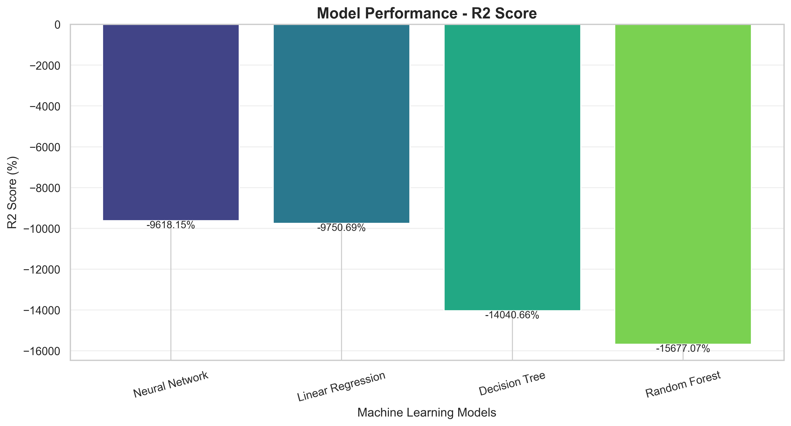

The graph helps identify differences in predictive performance across the evaluated models.

Higher R² generally indicates better predictive fit.

### 2. Actual vs Predicted Values

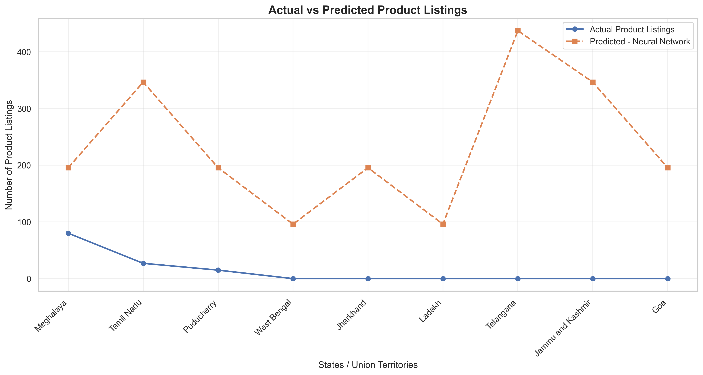

This graph compares actual product listing counts against predicted values for the test states.

### 3. Model Error Comparison

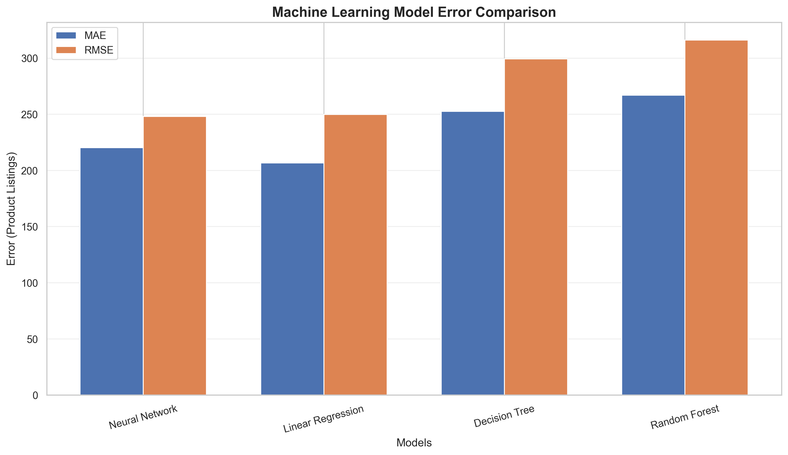

This graph compares MAE and RMSE values across models.

Lower error values indicate better predictive performance.

### 4. Machine Learning Model Comparison

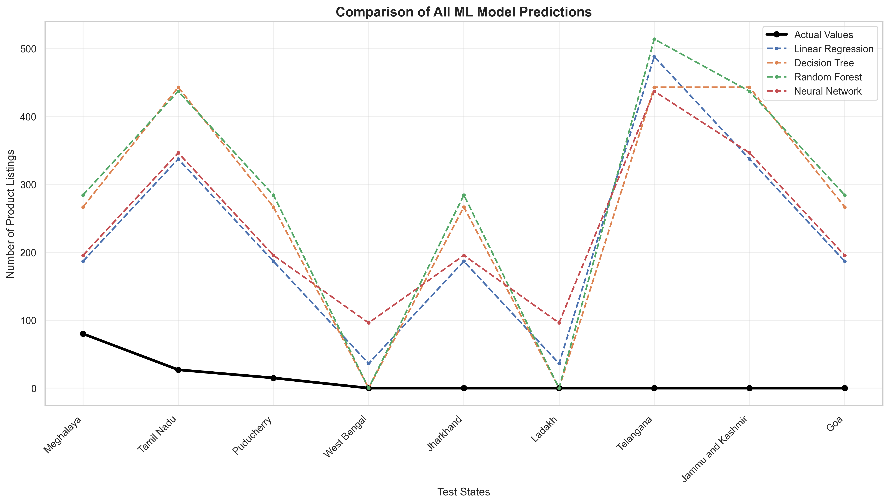

This visualization compares predictions generated by different Machine Learning models.

### 5. Correlation Heatmap

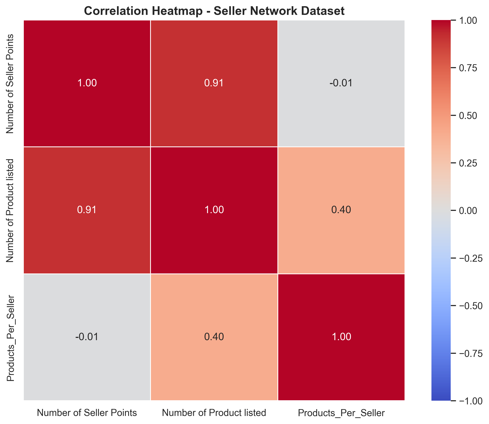

The heatmap displays relationships among numerical dataset features and derived metrics.

### 6. AIS Performance

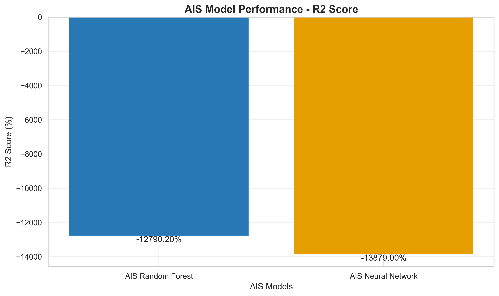

This graph displays R² scores for AIS-optimized models.

### 7. AIS Optimization Convergence

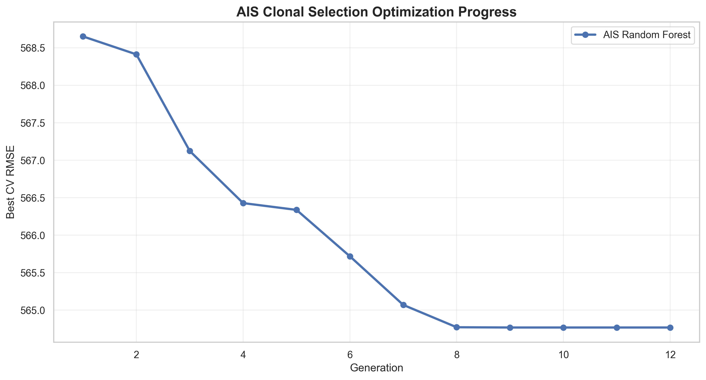

This graph shows how the best Random Forest cross-validation RMSE changes across AIS generations.

### 8. AIS Neural Network Convergence

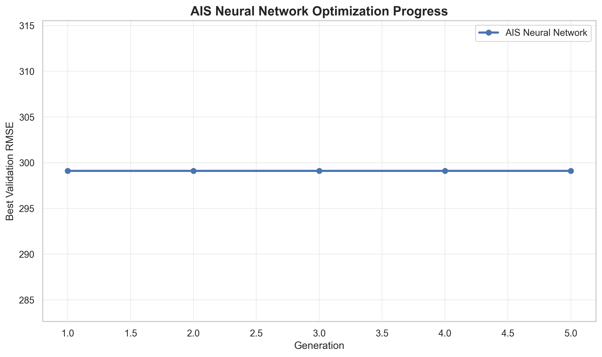

This graph shows AIS neural network optimization progress.

### 9. PSO Performance

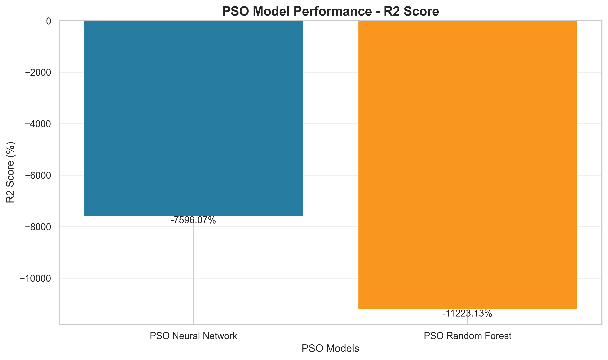

This graph compares PSO-optimized model performance.

### 10. PSO Optimization Convergence

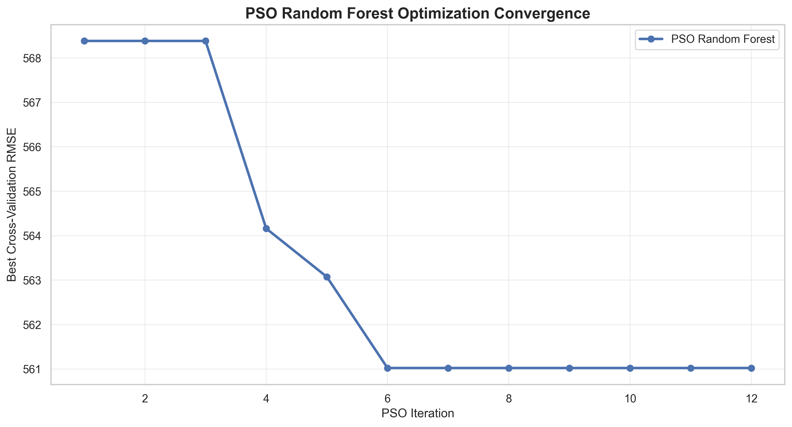

This graph displays the best Random Forest fitness across PSO iterations.

### 11. PSO Neural Network Convergence

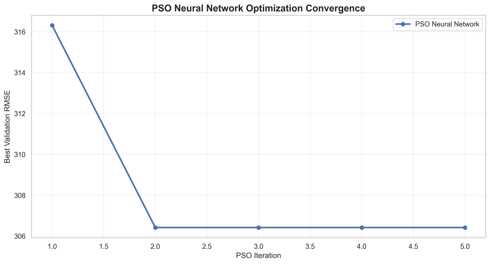

This graph displays PSO neural network optimization progress.

---

## 📁 Project Folder Structure

```text
AI-Based State-Wise Seller Network and Product Availability Analysis and Prediction/
│
├── RS_Session_262_AU_869_A_to_B_i.csv
│
├── train_model.py
├── analysis.py
├── ais_analysis.py
├── pso_analysis.py
│
├── model.h5
├── model.pkl
├── config.yaml
├── metadata.json
│
├── accuracy_graph.png
├── prediction.csv
├── prediction_graph.png
├── result.csv
├── result_graph.png
├── comparison_graph.png
├── heatmap.png
│
├── ais_model.h5
├── ais_model.pkl
├── ais_config.yaml
├── ais_metadata.json
│
├── ais_accuracy_graph.png
├── ais_prediction.csv
├── ais_prediction_graph.png
├── ais_result.csv
├── ais_result_graph.png
├── ais_comparison_graph.png
├── ais_heatmap.png
├── ais_fitness_graph.png
├── ais_nn_fitness_graph.png
├── ais_optimization_history.csv
├── ais_nn_optimization_history.csv
│
├── pso_model.h5
├── pso_model.pkl
├── pso_config.yaml
├── pso_metadata.json
│
├── pso_accuracy_graph.png
├── pso_prediction.csv
├── pso_prediction_graph.png
├── pso_result.csv
├── pso_result_graph.png
├── pso_comparison_graph.png
├── pso_heatmap.png
├── pso_fitness_graph.png
├── pso_nn_fitness_graph.png
├── pso_optimization_history.csv
├── pso_nn_optimization_history.csv
│
└── README.md
```

---

## 🛠️ Technologies Used

### Programming Language

- Python

### Data Processing

- Pandas
- NumPy

### Machine Learning

- Scikit-learn

### Deep Learning

- TensorFlow
- Keras

### Optimization Algorithms

- Artificial Immune System
- Clonal Selection Algorithm
- Particle Swarm Optimization

### Visualization

- Matplotlib
- Seaborn

### Model Storage

- Pickle
- HDF5
- YAML
- JSON

### Development Tools

- Visual Studio Code
- Jupyter Notebook
- Python

---

## ⚙️ Installation

### Step 1: Install Python

Install Python from:

https://www.python.org/downloads/

A compatible Python version with TensorFlow support is required.

### Step 2: Download the Project

Clone the repository:

```bash
git clone https://github.com/YOUR_USERNAME/YOUR_REPOSITORY.git
```

Replace `YOUR_USERNAME` and `YOUR_REPOSITORY` with your GitHub details.

Alternatively, download the project as a ZIP file.

### Step 3: Navigate to Project Directory

```bash
cd "AI-Based State-Wise Seller Network and Product Availability Analysis and Prediction"
```

### Step 4: Create a Virtual Environment

```bash
python -m venv venv
```

Activate the environment on Windows:

```bash
venv\Scripts\activate
```

### Step 5: Install Dependencies

```bash
pip install numpy pandas scikit-learn matplotlib seaborn tensorflow pyyaml h5py
```

### Step 6: Configure Dataset Path

Open the Python scripts and update `BASE_DIR` to match your project location.

Example:

```python
BASE_DIR = r"C:\Users\sagni\Downloads\AI-Based State-Wise Seller Network and Product Availability Analysis and Prediction"
```

The CSV dataset should be located inside this folder.

---

## 🚀 How to Run the Project

### 1. Train the Initial Models

```bash
python train_model.py
```

This script trains traditional Machine Learning models and a neural network.

Generated files include:

- `model.pkl`
- `model.h5`
- `config.yaml`
- `metadata.json`

### 2. Generate Baseline Predictions and Graphs

```bash
python analysis.py
```

This script generates:

- Model performance graph
- Prediction CSV
- Prediction graph
- Result CSV
- Result graph
- Comparison graph
- Correlation heatmap

### 3. Run AIS Optimization

```bash
python ais_analysis.py
```

This script executes the Artificial Immune System optimization workflow.

It generates optimized models, prediction results, evaluation metrics, fitness histories, and visualizations.

All generated files begin with:

```text
ais_
```

### 4. Run PSO Optimization

```bash
python pso_analysis.py
```

This script executes Particle Swarm Optimization.

It generates optimized models, prediction results, evaluation metrics, convergence histories, and visualizations.

All generated files begin with:

```text
pso_
```

---

## 📄 Output Files

### Baseline Model Outputs

| File | Purpose |
|------|---------|
| model.pkl | Saved best scikit-learn regression pipeline |
| model.h5 | Saved neural network |
| config.yaml | Training configuration |
| metadata.json | Model metadata and metrics |
| result.csv | Regression evaluation results |
| prediction.csv | Test-set predictions |

### AIS Outputs

| File | Purpose |
|------|---------|
| ais_model.pkl | AIS-optimized Random Forest |
| ais_model.h5 | AIS-optimized neural network |
| ais_result.csv | AIS model evaluation |
| ais_prediction.csv | AIS prediction results |
| ais_optimization_history.csv | AIS RF optimization progress |
| ais_nn_optimization_history.csv | AIS NN optimization progress |

### PSO Outputs

| File | Purpose |
|------|---------|
| pso_model.pkl | PSO-optimized Random Forest |
| pso_model.h5 | PSO-optimized neural network |
| pso_result.csv | PSO model evaluation |
| pso_prediction.csv | PSO prediction results |
| pso_optimization_history.csv | PSO RF optimization progress |
| pso_nn_optimization_history.csv | PSO NN optimization progress |

---

## 🔍 Prediction Process

The prediction system follows these steps:

1. Load the dataset.
2. Select the seller point count as the input feature.
3. Apply preprocessing.
4. Train the prediction model.
5. Optimize hyperparameters when using AIS or PSO.
6. Predict product listing counts.
7. Compare predictions against actual values.
8. Evaluate model performance.
9. Save results in CSV format.
10. Generate visualizations.

### Example Input

```text
Number of Seller Points = 5
```

### Example Output

```text
Predicted Product Listings = Model-generated value
```

The prediction depends on the trained model and dataset.

---

## 📊 Comparative Analysis

The project supports comparisons among:

| Approach | Models | Optimization |
|----------|--------|--------------|
| Baseline ML | Linear Regression, Decision Tree, Random Forest | Default or manually selected parameters |
| Baseline Deep Learning | Neural Network | Adam-based training |
| AIS | Random Forest, Neural Network | Clonal Selection |
| PSO | Random Forest, Neural Network | Particle Swarm Optimization |

The comparison considers:

- Mean Absolute Error
- Root Mean Squared Error
- R² Score
- Prediction differences
- Optimization convergence

### Expected Analysis

The experiments can help determine:

- Whether optimization improves model performance.
- Which model has the lowest prediction error.
- Whether nonlinear models capture useful relationships.
- How AIS and PSO differ in their search behavior.
- Whether additional data is required for reliable prediction.

No optimization technique is guaranteed to outperform baseline models.

Actual performance should be determined from the generated CSV results.

---

## 🌍 Applications

Potential applications of the project include:

### 1. Regional Market Analysis

Analyze geographical differences in seller participation and product availability.

### 2. Seller Network Assessment

Identify regions with comparatively high or low seller point counts.

### 3. Product Availability Analysis

Study differences in product listing counts across states.

### 4. Market Expansion Planning

Provide exploratory insights that may support regional expansion discussions.

### 5. Decision Support

Generate reports and visualizations for understanding seller network patterns.

### 6. Academic Research

Compare traditional Machine Learning and bio-inspired optimization techniques on a small structured dataset.

---

## ⚠️ Project Limitations

The project has several important limitations.

### 1. Small Dataset

The dataset contains a limited number of regional observations.

This can make predictive performance unstable.

### 2. Limited Input Features

The primary predictive feature is the number of seller points.

Other factors influencing product availability are not included.

### 3. No Time-Series Information

The dataset does not contain historical timestamps.

Therefore, the models cannot perform genuine future trend forecasting.

### 4. Limited Generalization

Models trained on a small number of states may not generalize well to new regions or changing market conditions.

### 5. Optimization Limitations

AIS and PSO optimize model hyperparameters but cannot compensate for missing predictive information.

### 6. Evaluation Limitations

The implementations use small training and testing partitions.

The reported results should be treated as exploratory.

For stronger evaluation, nested cross-validation or repeated cross-validation can be considered.

---

## 🔮 Future Enhancements

The project can be extended through:

1. Integration of additional regional datasets.
2. Historical seller and product listing records.
3. Population and economic indicator features.
4. State-wise geographical visualization.
5. Interactive dashboards using Streamlit.
6. Advanced ensemble learning techniques.
7. Additional optimization algorithms.
8. Automated hyperparameter search.
9. Model explainability using SHAP.
10. Deployment through a web application.

With historical data, future versions could support time-series forecasting.

---

## 🏆 Expected Outcomes

The project aims to deliver:

- A cleaned state-wise seller network dataset.
- Statistical analysis of seller and product distribution.
- Multiple trained regression models.
- AIS-optimized prediction models.
- PSO-optimized prediction models.
- Model evaluation reports.
- Prediction CSV files.
- Correlation heatmaps.
- Performance comparison graphs.
- Optimization convergence graphs.
- Reusable trained model artifacts.

---

## 📚 References

1. Scikit-learn Documentation  
   https://scikit-learn.org/stable/

2. TensorFlow Documentation  
   https://www.tensorflow.org/

3. Keras Documentation  
   https://keras.io/

4. Pandas Documentation  
   https://pandas.pydata.org/

5. NumPy Documentation  
   https://numpy.org/

6. Matplotlib Documentation  
   https://matplotlib.org/

7. Seaborn Documentation  
   https://seaborn.pydata.org/

8. Particle Swarm Optimization — Kennedy and Eberhart (1995)

9. Artificial Immune Systems — de Castro and Timmis (2002)

---

## 📜 Conclusion

The **AI-Based State-Wise Seller Network and Product Availability Analysis and Prediction** project demonstrates the application of Machine Learning, Deep Learning, and bio-inspired optimization algorithms to regional seller network and product availability data.

The project implements baseline prediction models alongside Artificial Immune System and Particle Swarm Optimization approaches.

By combining data preprocessing, regression modeling, hyperparameter optimization, evaluation metrics, and graphical visualization, the system provides an experimental framework for studying state-wise product listing patterns.

The generated reports and graphs support comparative analysis of different modeling approaches.

Although the limited dataset restricts predictive reliability, the project provides a foundation for future development using larger, richer, and historical datasets.

---

## ⭐ Project Summary

**Project Title:** AI-Based State-Wise Seller Network and Product Availability Analysis and Prediction

**Domain:** Artificial Intelligence and Machine Learning

**Dataset:** State-Wise Seller Points and Product Listings

**Prediction Type:** Regression

**Baseline Algorithms:** Linear Regression, Decision Tree, Random Forest, Artificial Neural Network

**Optimization Algorithms:** Artificial Immune System (AIS), Particle Swarm Optimization (PSO)

**Evaluation Metrics:** MAE, RMSE, R²

**Programming Language:** Python

**Output Formats:** CSV, PNG, PKL, H5, YAML, JSON

---

⭐ If you find this project useful, consider starring the repository.
